

<a href="https://dcuko.github.io/"></a>

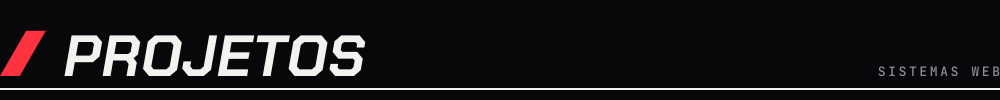
<a href="https://dcuko.github.io/projetos/perimo-fit/">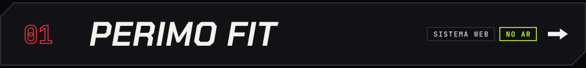</a>
<a href="https://dcuko.github.io/projetos/perimo-access/">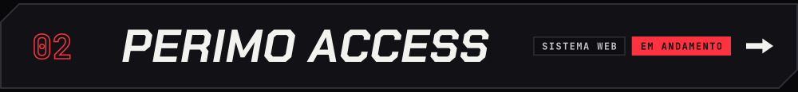</a>

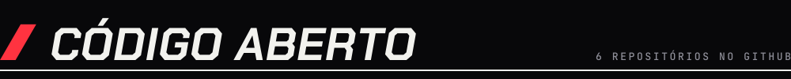
<a href="https://github.com/Dcuko/Web-Coup">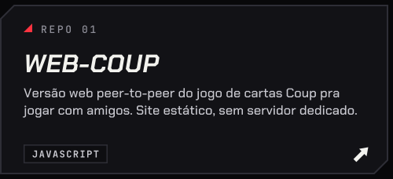</a><a href="https://github.com/Dcuko/AI-Tracker">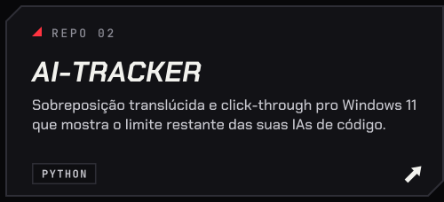</a>
<a href="https://github.com/Dcuko/Copy-to-Up">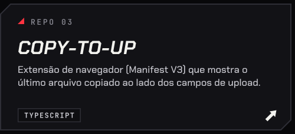</a><a href="https://github.com/Dcuko/Jully">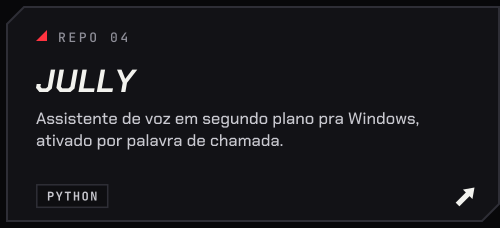</a>
<a href="https://github.com/Dcuko/MapIM">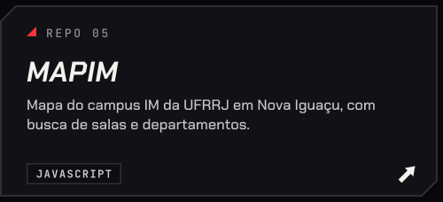</a><a href="https://github.com/Dcuko/Dcuko.github.io">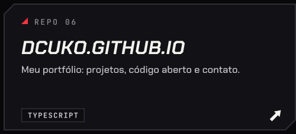</a>

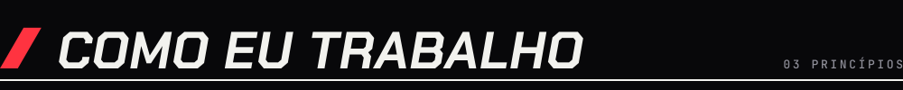
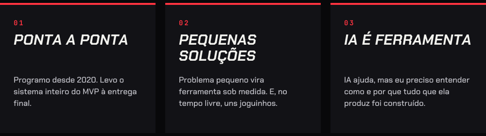

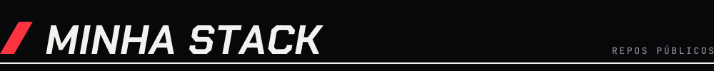

<a href="https://dcuko.github.io/contato/">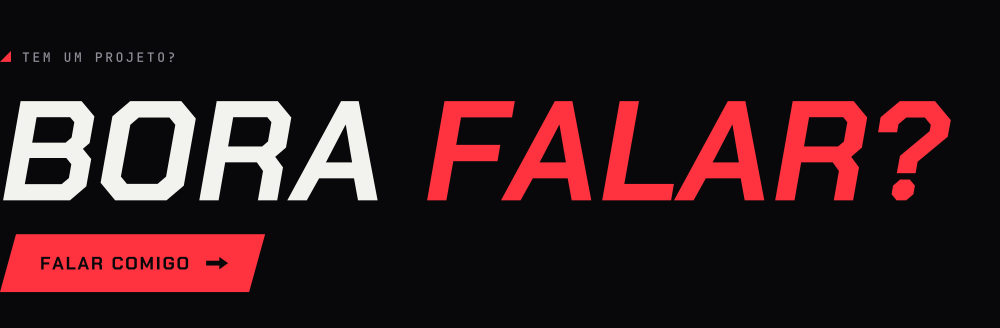</a>
<a href="https://dcuko.github.io/">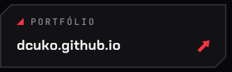</a><a href="mailto:augustonf2005@gmail.com">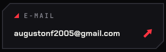</a><a href="https://linkedin.com/in/augustonf/">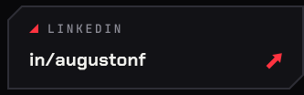</a>

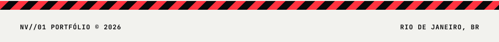

"# Dcuko" 
